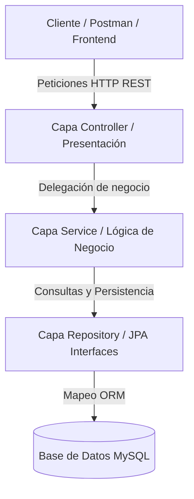

# AgroValle Connect 🌾

> Plataforma tecnológica orientada a optimizar la cadena de comercialización agrícola en el Departamento del Valle del Cauca, conectando de forma directa a agricultores, compradores y transportistas para eliminar intermediarios y garantizar un comercio justo.

---

## 👥 Datos Académicos e Integrantes

* **Institución:** Institución Universitaria Antonio José Camacho (UniAJC)
* **Facultad / Programa:** Facultad de Ingeniería | Ingeniería de Sistemas
* **Asignatura:** Ingeniería de Software
* **Docente:** Paola Andrea Bedoya
* **Estudiante / Desarrollador:** Emmanuel Vidal Moreno (`evidalm`)

---

## 🛠️ Stack Tecnológico

* **Lenguaje de Programación:** Java 17
* **Framework Backend:** Spring Boot (Spring Data JPA, Spring Web)
* **Base de Datos:** MySQL (Esquema relacional con DDL optimizado)
* **Gestor de Dependencias:** Apache Maven
* **Metodología Agil:** Scrum (Backlog de 18 Historias de Usuario con BDD, MoSCoW y Fibonacci)

---

## 📊 Diagrama de Arquitectura (Mermaid)

## 📂 Estructura Oficial del Repositorio

AgroValle-Connect/
├── docs/
│   ├── ieee29148-req01.md      # Especificación de Requisitos según estándar IEEE 29148
│   ├── dod.md                  # Definition of Done (Definición de Hecho técnica)
│   ├── sprint-1-planning.md    # Planificación y descomposición técnica del Sprint 1 (9 pts)
│   ├── sprint-2-planning.md    # Planificación y descomposición técnica del Sprint 2 (9 pts)
│   └── diseno/
│       ├── arquitectura-mvc-gof.md # Explicación de la arquitectura de 4 capas y patrones GoF
│       ├── schema.sql              # Script DDL de la base de datos relacional
│       └── (Diagramas DER, Secuencia, Componentes, Despliegue y Mockups)
├── src/                        # Código fuente Java 17 / Spring Boot
│   └── main/java/com/agrovalle/
│       ├── controller/         # REST Controllers
│       ├── model/              # Entidades JPA
│       ├── repository/         # Interfaces JpaRepository
│       └── service/            # Lógica de Negocio
├── BACKLOG.md                  # Product Backlog oficial (18 HUs con BDD, MoSCoW y Fibonacci)
└── README.md                   # Presentación del proyecto y guía técnica
