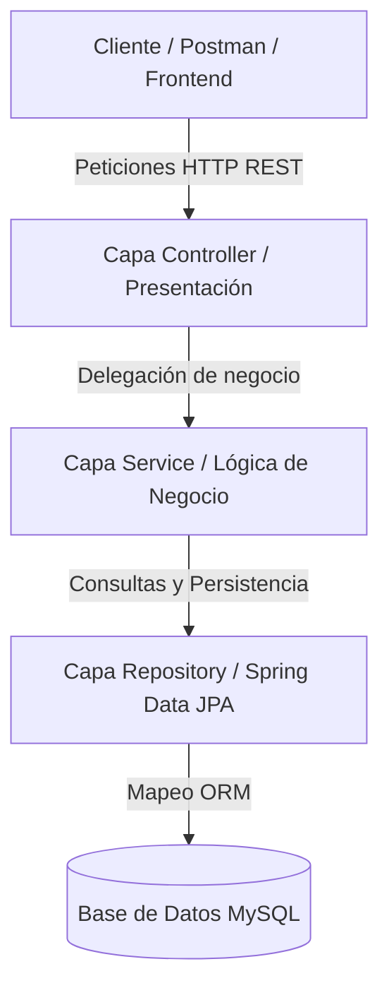

# 🌱 AgroValle Connect

Plataforma desarrollada para conectar agricultores del Valle del Cauca con compradores, facilitando la comercialización de productos agrícolas mediante una arquitectura basada en Spring Boot, MySQL y buenas prácticas de Ingeniería de Software.

---

# 👥 Equipo de Desarrollo

- Emmanuel Vidal Moreno
- Michael David Robayo
- Josse Manuel Bolaños

---

# 🎯 Objetivo del Proyecto

AgroValle Connect busca fortalecer la economía agrícola regional mediante una plataforma que permita:

- Registrar productores agrícolas.
- Publicar productos disponibles para la venta.
- Consultar productos por municipio.
- Gestionar pedidos agrícolas.
- Facilitar la integración futura de logística y pagos digitales.

---

# 🏗️ Arquitectura del Sistema

El proyecto implementa una arquitectura MVC de 4 capas utilizando Spring Boot.

## Capas

### Presentación (Controller)

Gestiona las solicitudes HTTP y las respuestas REST.

Ejemplos:

- UsuarioController
- ProductoController

### Lógica de Negocio (Service)

Implementa las reglas del negocio.

Ejemplos:

- UsuarioService
- ProductoService

### Persistencia (Repository)

Gestiona el acceso a la base de datos mediante Spring Data JPA.

Ejemplos:

- UsuarioRepository
- ProductoRepository

### Datos (Model)

Representa las entidades persistidas en la base de datos.

Ejemplos:

- Usuario
- Producto

---

# 📊 Diagrama de Arquitectura (Mermaid)



---

# 🛠️ Tecnologías Utilizadas

## Backend

- Java 17
- Spring Boot 3.2.5
- Spring Data JPA
- Maven
- MySQL

## Calidad de Software

- JUnit 5
- Mockito
- JaCoCo

## DevOps

- Git
- GitHub
- GitHub Actions

## Gestión Ágil

- Scrum
- Kanban
- Scrumban
- GitHub Projects

---

# 📂 Estructura del Proyecto

```text
AgrovalleConnect-Repositorio
│
├── .github
│   └── workflows
│       └── ci.yml
│
├── docs
│   ├── arquitectura-mvc-gof.md
│   ├── canvas.md
│   ├── dod.md
│   ├── ieee29148-req01.md
│   ├── diagrama-componentes.md
│   ├── diagrama-despliegue.md
│   ├── diagrama-secuencia.md
│   ├── sprint-1-planning.md
│   └── sprint-2-planning.md
│
├── src
│   ├── main
│   │   ├── java
│   │   │   └── com.agrovalle
│   │   │       ├── controller
│   │   │       ├── model
│   │   │       ├── repository
│   │   │       ├── service
│   │   │       └── Main.java
│   │   │
│   │   └── resources
│   │       └── application.properties
│   │
│   └── test
│       └── java
│           └── com.agrovalle
│               ├── model
│               └── service
│
├── BACKLOG.md
├── pom.xml
└── README.md
```

---

# ✅ Funcionalidades Implementadas

## Gestión de Usuarios

- Registro de usuarios.
- Consulta de usuarios.
- Consulta por identificación.
- Eliminación de usuarios.

## Gestión de Productos

- Registro de productos agrícolas.
- Consulta de productos.
- Consulta por municipio.
- Eliminación de productos.

---

# 🧪 Pruebas y Calidad

## Pruebas Unitarias

Implementadas utilizando:

- JUnit 5
- Mockito

Pruebas realizadas sobre:

- UsuarioService
- ProductoService
- Usuario
- Producto

---

## Cobertura JaCoCo

Cobertura actual del proyecto:

```text
64%
```

Cumpliendo el requisito mínimo establecido para el Segundo Corte.

---

# ⚙️ Integración Continua (CI/CD)

Se implementó un pipeline automático mediante GitHub Actions.

El flujo ejecuta:

```bash
mvn clean test verify
```

Validando automáticamente:

- Compilación del proyecto.
- Ejecución de pruebas.
- Verificación de calidad.

---

# 📋 Gestión del Proyecto

La planificación y seguimiento se realizó mediante GitHub Projects utilizando metodología Scrumban.

Columnas utilizadas:

- Backlog
- In Progress
- In Review
- Done

También se configuraron límites WIP (Work In Progress) para controlar el flujo de trabajo.

---

# 📚 Documentación

Toda la documentación del proyecto se encuentra en la carpeta:

```text
docs/
```

Incluye:

- IEEE 29148
- Canvas de negocio
- Definition of Done (DoD)
- Diagramas UML
- Arquitectura MVC
- Sprint 1 Planning
- Sprint 2 Planning

---

# 🚀 Estado Actual

✅ Arquitectura MVC implementada

✅ Persistencia con Spring Data JPA

✅ Integración con MySQL

✅ GitHub Actions funcionando

✅ Pruebas Unitarias implementadas

✅ Cobertura JaCoCo del 64%

✅ Gestión Scrum/Kanban mediante GitHub Projects

✅ Documentación completa del Segundo Corte

---

# 📖 Universidad

Institución Universitaria Antonio José Camacho

Programa:

Ingeniería de Sistemas

Asignatura:

Ingeniería de Software II

Proyecto Integrador:

AgroValle Connect
