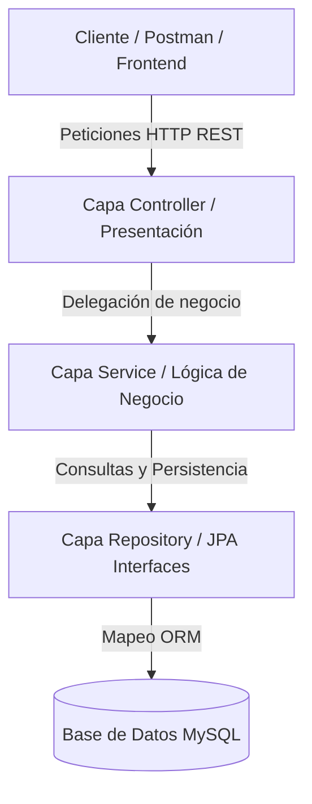

# AgroValle Connect 🌾

> Plataforma tecnológica orientada a optimizar la cadena de comercialización agrícola en el Departamento del Valle del Cauca, conectando de forma directa a agricultores, compradores y transportistas para eliminar intermediarios y garantizar un comercio justo.

---

## 👥 Datos Académicos e Integrantes

* **Institución:** Institución Universitaria Antonio José Camacho (UniAJC)
* **Facultad / Programa:** Facultad de Ingeniería | Ingeniería de Sistemas
* **Asignatura:** Ingeniería de Software
* **Docente:** Paola Andrea Bedoya
* **Estudiantes / Desarrolladores:** Emmanuel Vidal Moreno, Micael David Robayo 

---

## 🛠️ Stack Tecnológico

* **Lenguaje de Programación:** Java 17
* **Framework Backend:** Spring Boot (Spring Data JPA, Spring Web)
* **Base de Datos:** MySQL (Esquema relacional con DDL optimizado)
* **Gestor de Dependencias:** Apache Maven
* **Metodología Agil:** Scrum (Backlog de 18 Historias de Usuario con BDD, MoSCoW y Fibonacci)

---

## 📊 Diagrama de Arquitectura (Mermaid)

## 📂 Estructura Oficial del Repositorio

