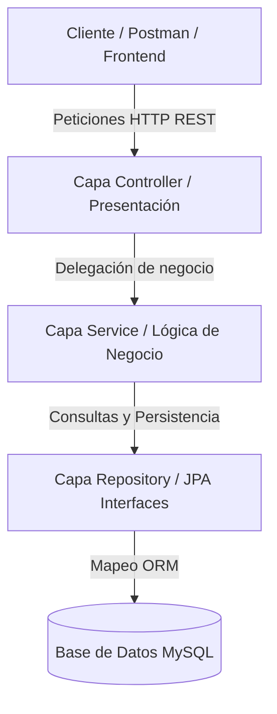

# 🌱 AgroValle Connect

Plataforma desarrollada para conectar agricultores del Valle del Cauca con compradores, facilitando la gestión de productos agrícolas, la visibilidad de la oferta local y la automatización de procesos mediante buenas prácticas de Ingeniería de Software.

---

## 👥 Integrantes

- Emmanuel Vidal Moreno
- Michael David Robayo
- Josse Manuel Bolaños

---

## 🎯 Objetivo del Proyecto

AgroValle Connect busca fortalecer la comercialización agrícola permitiendo que productores publiquen sus productos y que compradores puedan consultar la oferta disponible organizada por municipios y categorías.

---

## 🏗️ Arquitectura

El sistema se implementa siguiendo una arquitectura MVC de 4 capas:

```text
Controller
    ↓
Service
    ↓
Repository
    ↓
Model / Database
```


