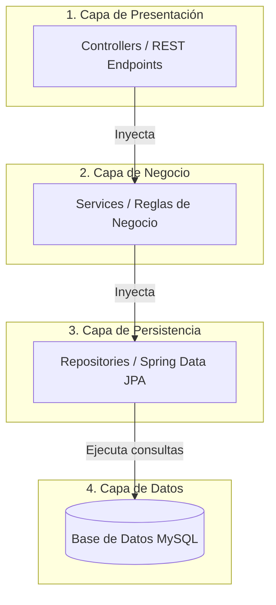

# Arquitectura de 4 Capas y Patrones de Diseño GoF — AgroValle Connect

Este documento describe la arquitectura de software implementada en el backend de **AgroValle Connect**, estructurada bajo el patrón **MVC de 4 Capas** y complementada con **Patrones de Diseño GoF (Gang of Four)** para garantizar escalabilidad, mantenibilidad y bajo acoplamiento en Java 17 y Spring Boot.

---

## 1. Arquitectura de 4 Capas

El sistema desacopla sus responsabilidades en cuatro capas lógicas bien definidas:

1. **Capa de Presentación / Controladores (`controller`)**

   * **Propósito:** Recibir las solicitudes HTTP del cliente (REST API), validar los datos de entrada y retornar las respuestas con los códigos HTTP correspondientes (200, 201, 400, 403, 404).
   * **Componentes:** `UsuarioController`, `ProductoController`, `FleteController`, etc.
2. **Capa de Lógica de Negocio / Servicios (`service`)**

   * **Propósito:** Contener las reglas de negocio de la aplicación, cálculos de tarifas, validaciones de fechas de cosecha y procesamiento de transacciones.
   * **Componentes:** `UsuarioService`, `ProductoService`, `FleteService`, etc.
3. **Capa de Persistencia / Repositorios (`repository`)**

   * **Propósito:** Gestionar la comunicación con la base de datos relacional MySQL abstrayendo las consultas SQL mediante interfaces de Spring Data JPA.
   * **Componentes:** `UsuarioRepository`, `ProductoRepository`, `FleteRepository`, etc.
4. **Capa de Modelos / Entidades (`model`)**

   * **Propósito:** Representar el esquema relacional de la base de datos a través de objetos de dominio mapeados mediante anotaciones JPA (`@Entity`, `@Table`).
   * **Componentes:** `Usuario`, `Producto`, `Flete`, `Calificacion`.

---

## 2. Patrones de Diseño GoF Implementados

* **Patrón Singleton:** Utilizado de forma implícita por el contenedor de Spring Boot (*Spring IoC Container*) para gestionar las instancias de los beans (Controllers, Services y Repositories), asegurando una única instancia en memoria por componente.
* **Patrón Repository (Patrón de Arquitectura / Datos):** Implementado a través de Spring Data JPA, separa la lógica de acceso a datos de la lógica de negocio mediante interfaces genéricas que proveen operaciones CRUD estándar.
* **Patrón Dependency Injection (Inyección de Dependencias):** Utilizado para desacoplar la creación de objetos, inyectando los servicios en los controladores mediante constructor (`@Autowired`), favoreciendo las pruebas unitarias y la mantenibilidad.

# Arquitectura MVC y Patrones GoF — AgroValle Connect

## Arquitectura MVC de 4 Capas (Spring Boot / Java 17)

